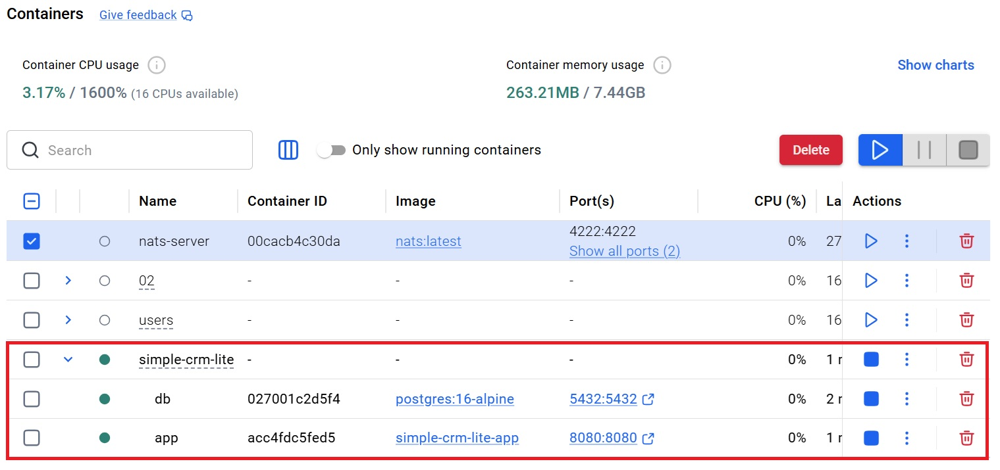
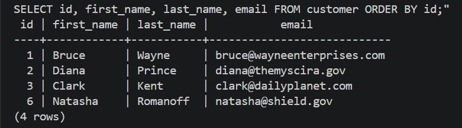
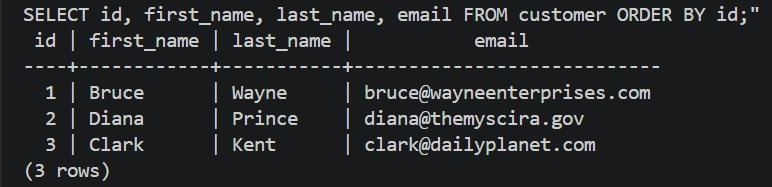

Completed Simple CRM Lite for [Lesson 4.8: Containerizing Simple-CRM-Lite (Saturday Coaching)](https://github.com/su-ntu-sctp/ai-4.8-Container-Practicals/blob/main/lesson.md)

### Docker Containers

Docker Compose creates and starts the applicarion and database containers

### Data Persisted

Newly created data persisted across `docker compose up/down`

### Sample Data Restored

Removing previous data volumne, trigger sample data to be added on application startup.

